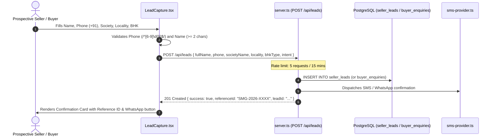
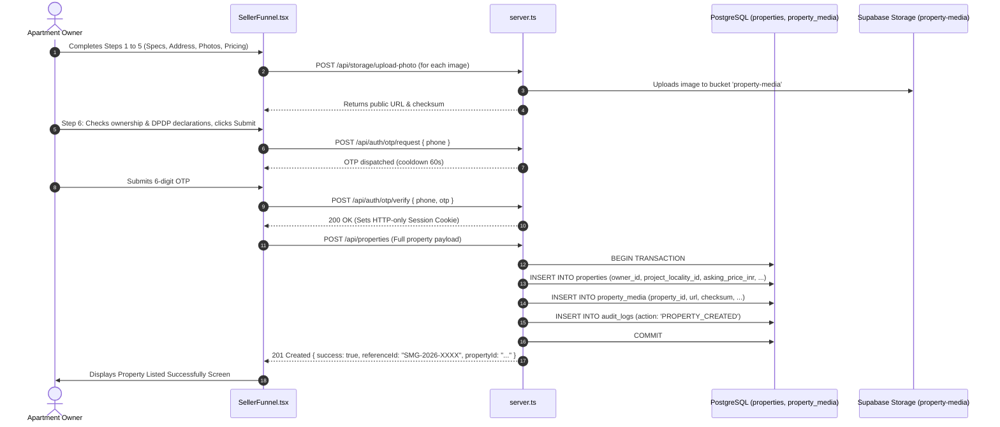

# SellMyGhar.in - Backend Contracts & Functional Dependencies

**Audit Date:** October 2026  
**Auditor:** Senior Product Architect & Full-Stack Engineer  
**Scope:** Complete verification of Express REST endpoints, PostgreSQL operations, Supabase Storage integrations, and frontend-to-backend data flows.

---

## 1. Data Layer & Database Dependencies

The application relies on 19 relational tables initialized via [`src/server/db/staging-schema.sql`](file:///Users/apple/.gemini/antigravity/scratch/SMG---MVP/src/server/db/staging-schema.sql). The database connection is managed via PostgreSQL connection pooling in [`src/server/db/pool.ts`](file:///Users/apple/.gemini/antigravity/scratch/SMG---MVP/src/server/db/pool.ts) with an in-memory dev sandbox store fallback ([`src/server/db/dev-sandbox-store.ts`](file:///Users/apple/.gemini/antigravity/scratch/SMG---MVP/src/server/db/dev-sandbox-store.ts)) enabled only when `ALLOW_DEV_FALLBACKS=true`.

### Core Tables & Entity Relationships

| Table Name | Primary Key | Key Foreign Keys & Constraints | Deletion Policy & Retention Safeguards |
| :--- | :--- | :--- | :--- |
| `users` | `id` (VARCHAR 64) | Unique `phone`, unique `LOWER(email)` | Root identity ledger. Hard delete blocked by RESTRICT on linked properties. |
| `user_identities` | `id` | `user_id -> users(id)` ON DELETE CASCADE | Unique `(provider, provider_user_id)`. Stores OAuth and phone auth links. |
| `consents` | `id` | `user_id -> users(id)` ON DELETE SET NULL | DPDP Section 6 notice & consent audit ledger. |
| `seller_leads` | `id` | `user_id -> users`, `property_id -> properties`, `assigned_staff_id -> users` (all SET NULL) | Inbound lead queue before full property onboarding. |
| `properties` | `id` | `owner_id -> users(id)` ON DELETE RESTRICT | **Statutory Retention:** RESTRICT prevents user erasure from purging property records. |
| `property_media` | `id` | `property_id -> properties(id)` ON DELETE CASCADE | **Marketing Lifecycle:** Stores replaceable marketing gallery photos. Cascades cleanly on non-retained property removal. |
| `documents` | `id` | `property_id -> properties(id)` ON DELETE RESTRICT, `uploader_user_id -> users(id)` ON DELETE RESTRICT | **Legal Title Diligence Vault:** Stores title deeds, tax receipts, encumbrance certificates. Protected by RESTRICT. |
| `deals` | `id` | `property_id -> properties(id)` ON DELETE RESTRICT, `buyer_user_id -> users(id)` ON DELETE SET NULL | **Statutory Escrow & Sales Ledger:** Governed by mandatory statutory retention hold. |
| `property_offers` | `id` | `property_id -> properties(id)` ON DELETE RESTRICT, `lead_id -> seller_leads(id)` ON DELETE SET NULL | Formal buyer purchase offers and counter-offers. |
| `visits` | `id` | `property_id -> properties(id)` ON DELETE RESTRICT, `assigned_staff_id -> users(id)` ON DELETE SET NULL | Scheduled physical buyer site inspections. |
| `buyer_enquiries` | `id` | `property_id -> properties(id)` ON DELETE SET NULL, `assigned_staff_id -> users(id)` ON DELETE SET NULL | Inbound buyer interest inquiries. |
| `erasure_requests` | `id` | `user_id -> users(id)` ON DELETE RESTRICT, `reviewed_by_admin_id -> users(id)` ON DELETE SET NULL | DPDP Section 12 Right to Erasure statutory requests. |
| `audit_logs` | `id` | None (Autonomous immutable event log) | Tracks all logins, status changes, image removals, and data modifications. |
| `hero_slides` | `id` | None | CMS homepage banner slides (1920x800). |
| `partner_logos` | `id` | None | CMS builder channel partner logo items. |
| `partner_section_settings`| `id` (`'default'`) | None | CMS marquee heading, scroll speed, and pause-on-hover settings. |
| `email_templates` | `template_key` | None | Transactional HTML email templates and placeholders. |
| `publication_notifications`| `id` | `property_id -> properties(id)` ON DELETE SET NULL | Idempotent transaction email dispatch records. |
| `sessions` | `id` | `user_id -> users(id)` ON DELETE CASCADE | Optional server session store. |

---

## 2. Storage Architecture & Bucket Policies

1. **Public Media Bucket (`property-media`):**
   - **Provider:** Supabase Storage.
   - **Access Level:** Public Read (`anon` key permitted to download and render images directly in ``).
   - **Contents:** Listing photographs, banner graphics, and builder logos (JPEG, PNG, WebP).
   - **Maximum File Size:** 10 MB per image.
   - **Validation:** Inspected for image MIME types before upload; assigned SHA-256 checksum and unique filename.

2. **Private Document Diligence Bucket (`property-documents`):**
   - **Provider:** Supabase Storage (with GCS client integration).
   - **Access Level:** Private / Restricted Read (Requires authenticated staff bearer token or time-limited pre-signed URLs).
   - **Contents:** Mother deeds, registered sale deeds, Encumbrance Certificates (EC), BBMP A-Khata extracts, and property tax paid receipts.
   - **Maximum File Size:** 25 MB per PDF.
   - **Verification:** Magic bytes verification (`VALID_PDF`), ClamAV antivirus engine scanning (`CLEAN` / `INFECTED`), SHA-256 checksum integrity verification.

---

## 3. End-to-End Functional Traces & API Contracts

---

### Flow 1: Public Inbound Lead Submission (`LeadCapture.tsx`)



- **Endpoint:** `POST /api/leads`
- **Rate Limit:** 5 requests per 15 minutes per IP (`leads-submit`).
- **Request Payload:**
  ```json
  {
    "fullName": "Kavitha R.",
    "phone": "+919845012345",
    "societyName": "Prestige Shantiniketan",
    "locality": "Whitefield",
    "bhkType": "3BHK",
    "builtUpSqft": "1650",
    "intent": "SELL",
    "listing_intent": "SELL"
  }
  ```
- **Response Contract (201 Created):**
  ```json
  {
    "success": true,
    "message": "Lead received successfully",
    "referenceId": "SMG-2026-4892",
    "leadId": "lead-m8q3f-1092"
  }
  ```
- **Error Responses:**
  - `400 Bad Request`: `{"error": "Please enter a valid 10-digit Indian mobile number."}`
  - `429 Too Many Requests`: `{"error": "Too many requests. Please try again later."}`

---

### Flow 2: Seller Assisted Property Onboarding (`SellerFunnel.tsx`)



- **Endpoint:** `POST /api/properties`
- **Authentication:** `authenticateUser` or `optionalAuthenticateUser` (authenticated via newly established OTP session).
- **Request Payload:**
  ```json
  {
    "propertyType": "Residential",
    "subType": "Flat / Apartment",
    "locality": "Whitefield",
    "subLocality": "Whitefield",
    "societyName": "Prestige Shantiniketan",
    "houseNo": "T4-1102",
    "wingTower": "Tower 4",
    "bedrooms": 3,
    "bathrooms": 3,
    "balconies": 2,
    "superBuiltUpSqft": 1550,
    "carpetAreaSqft": 1209,
    "furnishing": "Semi-Furnished",
    "floorNumber": 11,
    "totalFloors": 18,
    "facing": "East",
    "propertyAge": "1 to 5 years",
    "hasCoveredParking": true,
    "parkingCount": 1,
    "photos": ["https://.../img1.webp", "https://.../img2.webp"],
    "expectedPrice": 12500000,
    "isNegotiable": true,
    "maintenanceCharges": 5500,
    "ownerName": "Kavitha R.",
    "ownerPhone": "+919845012345",
    "description": "Premium 3 BHK corner apartment facing landscape gardens."
  }
  ```
- **Response Contract (201 Created):**
  ```json
  {
    "success": true,
    "message": "Property listing created successfully",
    "referenceId": "SMG-2026-7819",
    "propertyId": "prop-blr-9901"
  }
  ```

---

### Flow 3: Property Lifecycle & Merchandising (`PropertyEditor.tsx`)

#### 1. Fetch Property Details for CRM
- **Endpoint:** `GET /api/crm/properties/:id/details`
- **Permissions:** `authenticateUser`, `requireModule('PROPERTIES')`.
- **Response Contract (200 OK):**
  ```json
  {
    "success": true,
    "property": {
      "id": "prop-blr-9901",
      "projectName": "Prestige Shantiniketan",
      "localityName": "Whitefield",
      "bhkType": "3BHK",
      "superBuiltUpSqft": 1550,
      "carpetAreaSqft": 1209,
      "askingPriceInr": 12500000,
      "status": "DRAFT",
      "images": [
        { "id": "med-1", "url": "https://...", "is_featured": true, "display_order": 0 }
      ]
    },
    "owner": { "id": "usr-1", "name": "Kavitha R.", "phone": "+919845012345" },
    "linkedLead": null,
    "documents": [],
    "visits": [],
    "offers": []
  }
  ```

#### 2. Publish Property with Quality Validation
- **Endpoint:** `POST /api/crm/properties/:id/publish`
- **Validation Rule (`validatePropertyForPublish`):**
  - Title required and non-empty.
  - Property type and BHK required.
  - Locality and public address required.
  - Asking price > 0.
  - Super built-up area > 0.
  - Description required.
  - Minimum 1 primary featured image required (`hasPrimary === true`).
- **Response Contract:**
  - Success (200 OK): `{"success": true, "message": "Property published successfully", "status": "PUBLISHED"}`
  - Validation Failure (400 Bad Request):
    ```json
    {
      "success": false,
      "error": "Property validation failed before publish",
      "missingFields": ["primary_image", "description"],
      "errors": {
        "primary_image": "At least one primary image is required",
        "description": "Description is required"
      }
    }
    ```

#### 3. Property Image Management Operations
- **Upload Image:** `POST /api/crm/properties/:id/images` (FormData or Base64 JSON).
- **Delete Image:** `DELETE /api/crm/properties/:id/images/:imageId` (Executes `DELETE FROM property_media WHERE id = $1` and records `IMAGE_REMOVED` in `audit_logs`).
- **Set Featured:** `POST /api/crm/properties/:id/images/:imageId/primary` (Resets previous featured flags and marks selected image as primary).
- **Reorder Gallery:** `POST /api/crm/properties/:id/images/reorder` (`{ imageIds: string[] }` updates `display_order` sequentially).

---

### Flow 4: Physical Site Visit Scheduling & Notifications (`CalendarModule.tsx`)

#### 1. Schedule Visit
- **Endpoint:** `POST /api/crm/visits`
- **Permissions:** `authenticateUser`, `requireModule('VISITS')`.
- **Request Payload:**
  ```json
  {
    "property_id": "prop-blr-9901",
    "client_name": "Arun Kumar",
    "client_phone": "+919886012345",
    "visit_date": "2026-10-18",
    "visit_time": "11:00 AM",
    "assigned_staff_id": "usr-staff-closer-1",
    "notes": "Buyer interested in North/East facing 3BHKs with immediate loan eligibility."
  }
  ```
- **Response Contract (201 Created):**
  ```json
  {
    "success": true,
    "message": "Site visit scheduled successfully",
    "visit": {
      "id": "vis-8812",
      "status": "SCHEDULED",
      "visit_date": "2026-10-18",
      "visit_time": "11:00 AM"
    }
  }
  ```

#### 2. Dispatch WhatsApp Visit Reminder
- **Endpoint:** `POST /api/crm/visits/:id/whatsapp-reminder`
- **Permissions:** `authenticateUser`, `requireModule('VISITS')`.
- **Action:** Prepares formatted WhatsApp reminder text with client name, property title, date, time, and assigned closer contact; records `whatsapp_reminder_sent_at = NOW()` and logs audit event.
- **Response Contract (200 OK):**
  ```json
  {
    "success": true,
    "message": "WhatsApp reminder dispatched and logged successfully",
    "visitId": "vis-8812",
    "sentAt": "2026-10-11T12:45:00.000Z"
  }
  ```

---

### Flow 5: Statutory Consent Withdrawal & Right to Erasure (`ConsentPortal.tsx` & `AdminErasureQueue.tsx`)

#### 1. Customer Withdraws Statutory Consent
- **Endpoint:** `POST /api/compliance/withdraw-consent`
- **Request Payload:** `{"phone": "+919845012891", "purpose": "MARKETING_OPT_IN"}`
- **Action:** Updates `consents` record (`is_withdrawn = true, withdrawn_at = NOW()`), records audit log, and immediately ceases outbound communications for that purpose.
- **Response Contract (200 OK):**
  ```json
  {
    "status": "WITHDRAWN",
    "confirmationId": "wth-m8q3f-9912",
    "message": "Statutory consent successfully withdrawn under DPDP Act Section 6."
  }
  ```

#### 2. Customer Initiates Erasure Request
- **Endpoint:** `POST /api/compliance/erasure-request`
- **Rate Limit:** 5 per hour (`erasure-request`).
- **Request Payload:** `{"reason": "Property sold, please delete my personal records."}`
- **Action:** Computes cryptographic SHA-256 hash of phone and client IP, checks for active completed deals / statutory holds, inserts record into `erasure_requests` with status `PENDING_ADMIN_REVIEW`.

#### 3. Administrator Executes Erasure
- **Endpoint:** `POST /api/compliance/erasure-requests/:id/execute`
- **Permissions:** `authenticateUser`, `requireRole('STAFF_SUPER_ADMIN')`.
- **Statutory Limitation Hold Check:**
  - If user is party to a completed deal within 2,920 days (~8 years), erasure is **rejected** under statutory hold (`REJECTED_STATUTORY_HOLD`).
  - If eligible: Executes atomic PostgreSQL transaction:
    - Anonymizes unconverted leads (`owner_name = NULL, phone = 'erased_...'`).
    - Sanitizes unsold properties (`unit_number = '[ERASED]', notes = '[ERASED_UNDER_DPDP]'`).
    - Anonymizes user profile (`email = NULL, display_name = NULL, phone = 'erased_...'`).
    - Updates erasure request to `APPROVED_EXECUTED`.
    - Retains immutable audit record of erasure execution.

---

### Flow 6: Transactional Email Workflows & Idempotency (`PublicationEmailManager.tsx`)

#### Workflows Managed:
1. `PROPERTY_SUBMISSION_RECEIVED`: Dispatched immediately to seller upon wizard submission.
2. `MEETING_SCHEDULED`: Dispatched to buyer and closer with RFC 5545 `.ics` calendar invite attachment.
3. `PROPERTY_APPROVED`: Dispatched to seller when legal diligence review is approved.
4. `PROPERTY_PUBLISHED`: Dispatched to seller when property goes live with asking price and public URL.

#### Idempotency Enforcement:
- Each email dispatch calculates a deterministic `idempotency_key` (e.g. `pub-prop-9901-v1`).
- Records entry in `publication_notifications`. Duplicate events are suppressed to prevent spam.

---

## 4. Rate Limiting Matrix

The server enforces in-memory sliding window rate limits via [`src/server/ratelimit/limiter.ts`](file:///Users/apple/.gemini/antigravity/scratch/SMG---MVP/src/server/ratelimit/limiter.ts):

| Endpoint Route | Rate Limit Bucket | Window Size | Max Requests | Violation Response |
| :--- | :--- | :---: | :---: | :--- |
| `POST /api/auth/login` | `auth-login` | 15 mins (900s) | 10 | 429 Too Many Requests |
| `POST /api/auth/otp/request` | `otp-req` | 15 mins (900s) | 10 | 429 Too Many Requests |
| `POST /api/auth/otp/verify` | `otp-verify` | 15 mins (900s) | 10 | 429 Too Many Requests |
| `POST /api/auth/google/session` | `google-session` | 15 mins (900s) | 10 | 429 Too Many Requests |
| `POST /api/leads` | `leads-submit` | 15 mins (900s) | 5 | 429 Too Many Requests |
| `GET /api/listings/:id` | `listing-detail` | 1 min (60s) | 60 | 429 Too Many Requests |
| `POST /api/properties` | `property-create` | 1 hour (3600s)| 10 | 429 Too Many Requests |
| `POST /api/storage/upload-photo` | `photo-upload` | 5 mins (300s) | 30 | 429 Too Many Requests |
| `POST /api/properties/:id/documents`| `doc-upload` | 5 mins (300s) | 20 | 429 Too Many Requests |
| `POST /api/compliance/withdraw-consent`| `consent-withdraw`| 5 mins (300s) | 5 | 429 Too Many Requests |
| `POST /api/compliance/erasure-request`| `erasure-request` | 1 hour (3600s)| 5 | 429 Too Many Requests |
