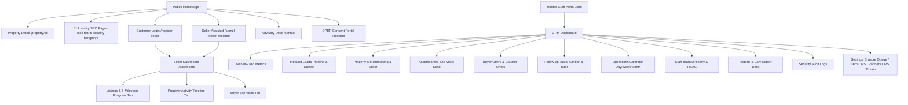

# Google Stitch Design Brief: SellMyGhar.in UI Redesign

> **IMPORTANT INSTRUCTION FOR GOOGLE STITCH:**  
> You are redesigning the UI of an existing, fully functional, production-ready real estate application called **SellMyGhar.in**.  
> **DO NOT INVENT A REPLACEMENT APPLICATION.**  
> **DO NOT REMOVE, REPLACE, OR OMIT ANY EXISTING FEATURE, SCREEN, TAB, OR DATA FIELD.**  
> Your task is to apply a premium, high-trust, professional visual redesign across all 14 screens, preserving 100% of the functional contracts, forms, validation barriers, lifecycle milestones, and database-backed workflows documented below. Where static designs cannot execute backend logic, represent the precise visual states (Default, Active, Hover, Loading, Error, Success) without altering the user journey.

---

## 1. Product Identity & Design Vision

### Commercial Positioning
SellMyGhar.in is a specialized residential apartment resale platform built exclusively for Bengaluru, Karnataka, India. Unlike open lead-generation classifieds (e.g. 99acres, MagicBricks), SellMyGhar operates a direct homeowner-assisted representation model:
- **Core Proposition:** "Sell your flat in 45 days."
- **Trust Pillars:** Zero Broker Spam, Kaveri 2.0 Registered Deed Diligence, Accompanied Physical Buyer Inspections, Karnataka RERA Compliance (`PRM/KA/RERA/1251`), and Digital Personal Data Protection (DPDP Act 2023) Notice & Erasure Compliance.
- **Geographic Focus:** 11 core Bengaluru apartment corridors (Hebbal, Thanisandra, Yelahanka, Jakkur, Hennur, Whitefield, Sarjapur Road, Bellandur, HSR Layout, JP Nagar, Indiranagar).

### Audience Roles
1. **Property Owners (Sellers):** High-net-worth Bengaluru homeowners selling flats priced between ₹80 Lakhs and ₹5+ Crores. Expect high dignity, zero unsolicited broker calls, clear progress visibility, and professional representation.
2. **Resale Homebuyers:** Qualified buyers seeking verified ready-to-move apartments with clear legal titles and transparent pricing.
3. **Internal Operations Staff:** Verification agents, listing managers, deal closers, and administrators handling daily lead intake, document vetting, accompanied visits, and offers.

---

## 2. Design System & Brand Tokens

The redesign must strictly adhere to the following brand palette and typographic hierarchy. Avoid generic AI-generated styling, excessive purple/cyan gradients, floating decorative 3D shapes, cartoonish badges, or cluttered unorganized tables.

### Color Palette

| Token Name | Hex Code | Visual Application |
| :--- | :--- | :--- |
| **Trust Blue (Primary)** | `#244B8F` | Primary action buttons, active navigation indicators, key brand headings, primary icons |
| **Trust Blue Dark** | `#1B396E` | Button hover states, top banner backgrounds, high-contrast dark accents |
| **Trust Blue Light** | `#3264BA` | Focus rings, subtle badge outlines, active card borders |
| **Ink (Primary Text)** | `#172033` | Primary page headings, body text, table headers, dark UI surfaces, footer background |
| **Canvas (Background)** | `#F4F6F9` | Global off-white background canvas, input field background, inactive tab fill |
| **Gold Accent (Restrained)**| `#B68A4A` | Eyebrow badges, Rosette badge accents, luxury township highlights, footer category headers |
| **Success Emerald** | `#059669` | "FREE" property posting badges, verified seals, active status pills, completed milestone checkmarks |
| **Warning Amber** | `#F59E0B` | In-review notices, counter-offer tags, scheduled visit status |
| **Alert / Danger Rose** | `#E11D48` | Overdue follow-up tags, statutory hold warnings, error banners, destructive action buttons |

### Typography Hierarchy

- **Headings Font Family:** **Montserrat** (`'Montserrat', -apple-system, sans-serif`)
  - Letter-spacing: `-0.025em`
  - Scale:
    - Display / Hero H1: `text-4xl` to `text-6xl` (36px – 60px), Font-weight 800 (Extra-Bold), Line-height 1.1
    - Section H2: `text-2xl` to `text-3xl` (24px – 30px), Font-weight 700 (Bold)
    - Card H3: `text-base` to `text-lg` (16px – 18px), Font-weight 700 (Bold)
    - Eyebrow / Label: `text-xs` (11px – 12px), Font-weight 700, Uppercase, Tracking `+0.05em`
- **Body & Controls Font Family:** **Poppins** (`'Poppins', -apple-system, sans-serif`)
  - Scale:
    - Body Regular: `text-sm` (14px) or `text-xs` (12px), Font-weight 400 (Regular) / 500 (Medium), Line-height 1.6
    - Buttons & Action Links: `text-xs` to `text-sm` (12px – 14px), Font-weight 600 (Semi-Bold) / 700 (Bold)
    - Numbers & Financial Data: Tabular figures (`font-variant-numeric: tabular-nums`)
- **Iconography Standard:** `lucide-react` line icons, 1.5px – 2px stroke width. Never use multicolored cartoon emoji icons.

### Surface Elevation & Corner Radii
- Standard Card Corners: `rounded-xl` (12px) or `rounded-2xl` (16px). Avoid extreme pill/bubble radii on content cards.
- Button Corners: `rounded-xl` (10px – 12px) for primary CTAs; `rounded-lg` (8px) for table/control buttons.
- Shadows: Soft, diffused shadows (`shadow-xs` / `shadow-sm` / `shadow-md`). Avoid heavy harsh drop shadows.
- Borders: Crisp, subtle borders (`border border-slate-200/90` or `border-slate-300`).

---

## 3. Global Navigation Hierarchy & Screen Topology

---

## 4. Screen-by-Screen Layout & Visual Design Requirements

---

### Screen 1: Public Homepage (`HOME`)

#### Visual Layout Structure
1. **Header (Sticky, 72px):**
   - Left: Official Brand Logo (`/logo.png`, height 40px).
   - Center: Navigation tabs: "For Owners" (with small blue "Sell Flat" badge), "For Buyers", "About", "Contact".
   - Right: "Post property [FREE]" button (white surface, dark border, vibrant emerald "FREE" pill), and dynamic user button: "Login / Register" (with User icon) or "My Dashboard" (with LayoutDashboard icon).
2. **Hero Section (Full-width, 640px height):**
   - Photographic background: 1920x800 luxury Bengaluru residential township backdrop with dark overlay gradient (`from-slate-950/90 via-slate-950/70 to-slate-950/40`).
   - Left Side (Headline Block):
     - Eyebrow: Blue pill `BENGALURU RESIDENTIAL RESALE`.
     - Headline (H1): **"Sell your flat in 45 days."** (White, Extra-Bold, 56px).
     - Subhead: "A structured resale process with Kaveri 2.0 deed benchmarking, legal title diligence, and pre-screened buyers across Bengaluru apartment corridors."
     - Action CTAs: Primary button "Sell My Flat" (Trust Blue `#244B8F`, arrow icon) + Secondary button "Browse Verified Flats" (Glassmorphic white/10, border white/20).
     - Demand Indicator Capsule: "Active buyer demand in:" + vertical capsule cycling through 11 Bengaluru localities (Hebbal, Whitefield, etc.) every 2.4s.
   - Right / Center (99acres-Inspired Marketplace Intake Card):
     - Elevated white card (`max-w-4xl`, `rounded-2xl`, crisp shadow).
     - Top Tab Bar: "Sell Flat" (Active, blue underline), "Buy Resale", "Rent", and green "Post Property FREE" pill.
     - Controls Row (3 columns):
       - Col 1 (BHK Selector): Dropdown with options: 1 BHK, 2 BHK, 2.5 BHK, 3 BHK, 3.5 BHK, 4 BHK+ Penthouse.
       - Col 2 (Society Autocomplete): Input with search icon `Search society (e.g. Prestige Shantiniketan, Sobha Dream Acres...)` displaying autocomplete dropdown.
       - Col 3 (Action Button): Trust Blue button **"Get 45-Day Plan"** with arrow icon.
     - Bottom Row: Popular societies quick pills (`Prestige Shantiniketan`, `Sobha Dream Acres`, `Brigade Gateway`, `Godrej Woodsman`) + "Looking to buy instead? Browse verified homes" link.
3. **Trusted Builder Partners Marquee (White section, border-y, 90px height):**
   - Heading: "TRUSTED CHANNEL PARTNERS OF" (Uppercase, slate-500, letter-spacing).
   - Seamless infinite marquee with edge gradient fade masks. Builder partner logos (Godrej Properties, Brigade Group, Sobha Realty, Prestige Group) inside uniform cards (`h-20`, `min-w-[190px]`, object-contain). Hover pauses marquee.
4. **Financial Cost of an Unsold Flat Calculator (Section #calculator, Canvas `#F4F6F9`):**
   - Compact white card (`max-w-5xl`, `rounded-2xl`, border slate-200).
   - Left Side (Inputs, 7 cols):
     - Expected Asking Price input (Default: ₹1.08 Cr, displays formatted value).
     - 2-col row: Super Built-up Area (1,461 sq.ft) & Maintenance Rate (₹5/sq.ft/mo).
     - Occupancy Status: Segmented control (Vacant vs Tenanted). If Vacant, displays Monthly Expected Rent input (₹40,000).
     - Holding Period Selector: 4-button group (`6 Months`, `9 Months`, `12 Months`, `18 Months`).
   - Right Side (Calculated Results Card, 5 cols, slate-50 border slate-200):
     - Breakdown list: Maintenance (₹87,660), Foregone Rent (₹4,80,000), Assumed Brokerage at 2% (₹2,16,000).
     - Total Card (Dark Navy `#172033`, white text): Large bold amount **₹7,83,660** + caption "Based on 12 months of holding before closing a sale."
     - Informational note with info icon on Kaveri 2.0 benchmarking.
     - Primary button: "Explore Selling Options".
5. **Verified Resale Inventory Grid (Section #listings, Canvas `#F4F6F9`):**
   - Header: Rosette icon + "VERIFIED RESALE INVENTORY" eyebrow, Title "Featured Apartments for Sale".
   - Filters Bar: BHK Chips (All BHKs, 1BHK, 2BHK, 2.5BHK, 3BHK, 3.5BHK, 4BHK+) + Locality quick selector (All Bengaluru, Whitefield, Panathur, Sarjapur, Hosur).
   - 3-Column Property Grid:
     - Aspect 16:10 photo with zoom on hover.
     - Top-left: White glassmorphic badge with Rosette icon and "Verified" text.
     - Top-right: Dark pill with BHK type (e.g. `3BHK`).
     - Bottom Asking Price Bar: Solid dark bar (`#172033/90`, no gradient) with price in Crores/Lakhs (e.g. `₹1.65 Cr`) and rate per sq.ft (e.g. `₹8,918/sq.ft`).
     - Details: Project name, Locality with pin icon.
     - 3-box attribute strip: SBUA Area (sq.ft), Facing (e.g. East), Floor (e.g. Floor 9-14).
     - Actions: Primary button "View Property" (opens detail page) + Secondary button "Quick Enquiry" (phone icon).
6. **11-Locality Micro-Markets Grid:**
   - Zone filter tabs (All, North Bengaluru, East Bengaluru, South Bengaluru, Central Bengaluru).
   - 11 locality cards displaying price band, rate/sqft, top 3 societies, and "Explore Resale" link.
7. **High-Contrast Seller Conversion Card:**
   - Deep navy-to-blue gradient banner (`#172033` to `#244B8F`) with subtle ambient radial accent.
   - Headline: "Your Bengaluru Flat Deserves a Clear Selling Plan."
   - Trust pillars: Zero Upfront Listing Fee, Confidential Phone Protection, Screened Apartment Buyers.
   - Dual CTAs: Primary "Start Selling My Flat" (White button with emerald "FREE ONBOARDING" pill) + Secondary "Speak to Our Team" (Outlined button).
8. **Footer:**
   - Bengaluru cityscape illustration watermark (`bengaluru-cityscape-footer.svg`) at 18% opacity behind content with gradient overlay.
   - 5-Column Grid: Brand logo & RERA approval, Quick Nav links, Legal & Privacy links (triggers DPDP modals), Office Coordinates, Copyright & Sub-Registrar notice.

---

### Screen 2: Verified Property Detail Page (`PROPERTY_DETAIL`)

#### Visual Layout Structure
- **Header:** Sticky minimal dark bar with "Back to Listings" and brand logo.
- **Top Summary:** Project name (H1), Locality, Official Rosette "Verified Legal Diligence" badge, Asking Price in Crores/Lakhs, Rate per sqft.
- **2-Column Workspace:**
  - **Left Column (8 cols):**
    - Gallery: Large active image with previous/next chevrons, thumbnail carousel strip, fullscreen lightbox trigger, Share button.
    - Key Attributes Bar: BHK, SBUA, Carpet Area, Floor Band, Facing, Bathrooms, Balconies, Car parks (covered/open).
    - **Verified Due Diligence Box (High Trust Visual):**
      - Grid of 6 verified green checkmark cards:
        1. Legal Tier: TIER-1 LEGAL VERIFIED
        2. Khata Status: BBMP A-Khata Verified
        3. Encumbrance: 15-Year NIL Encumbrance Certificate
        4. Title Deed: Clear Registered Mother Deed Verified
        5. Property Tax: Current Year Paid Receipt Verified
        6. Physical Inspection: Structural & Unit Inspection Completed
    - Public Description & Highlights.
    - Amenities Icon Grid (Swimming Pool, Clubhouse, Gym, EV Charging, etc.).
    - Developer Profile: Builder name, RERA Registration Number, Launch/Possession year.
    - Nearby Connectivity & Landmarks: Tech parks, metro stations, schools, hospitals with distances.
  - **Right Sticky Column (4 cols):**
    - Dedicated Relationship Manager Card: RM Photo, Name, "Assigned Bengaluru Resale Desk Lead", Verification badge.
    - **Accompanied Visit Booking Form:**
      - Full Name input.
      - 10-digit Indian Mobile input.
      - Preferred Slot dropdown (e.g. "This Saturday 11:00 AM", "This Sunday 3:30 PM").
      - Funding Mode radio group (Pre-Approved Home Loan, Self-Funded / Cash, Applying for Loan).
      - DPDP Statutory Consent checkbox (mandatory).
      - Primary Button: "Schedule Accompanied Visit".
      - Direct Contact: "Chat on WhatsApp" (prefilled property reference message) + "Call Advisory Desk" (+91 82178 73708).
      - Privacy reassurance: "Your contact is never shared with third-party brokers."
- **Bottom Section:** Similar Verified Properties carousel.

---

### Screen 3: Programmatic Locality SEO Landing Pages (`LOCALITY_DETAIL`)

#### Visual Layout Structure
- **Breadcrumbs:** `Home / Bengaluru Resale / Sell Flat in {Locality Name}`.
- **Hero Section:**
  - Zone Eyebrow (e.g. `NORTH BENGALURU • INTERNATIONAL AIRPORT CORRIDOR`).
  - H1: **"Sell Your Flat in {Locality Name}, Bengaluru With a Clear Plan."**
  - Supporting narrative on Kaveri 2.0 deed benchmarking and direct buyer absorption.
  - Primary CTA: "Start Selling My Flat in {Locality Name}" (pre-fills locality into intake wizard).
  - Secondary CTA: "Speak to {Locality Name} Desk".
- **4-Metric Intelligence Grid:**
  1. Indicative Resale Band (e.g. ₹1.20 Cr – ₹2.85 Cr)
  2. Corridor Benchmark Rate (e.g. ₹8,400 – ₹11,200 / sq.ft)
  3. Typical Society Maintenance (e.g. ₹4.5 – ₹6.0 / sq.ft/mo)
  4. Key Connectivity Hubs (e.g. Manyata Tech Park, KIADB Aerospace, Metro Phase 2B)
- **Top Gated Societies Grid:** Cards for popular gated societies with direct "List Here" quick buttons.
- **Mandatory Documents Required Checklist:** Title Deed, Mother Deed, Latest 15-year EC, BBMP A-Khata Certificate & Extract, Latest Tax Receipt, Society NOC, Bank Foreclosure Letter & LOD.
- **Kaveri 2.0 Sub-Registrar Guidance:** Exact Sub-Registrar office name, address, and statutory fee breakdown (5% stamp duty + 1% cess + 2% surcharge + 1% registration fee).
- **Locality FAQ Accordion:** Expandable questions addressing resale timelines, capital gains tax, and buyer demand in this micro-market.

---

### Screen 4: Seller Assisted Multi-Step Funnel (`SELLER_ASSISTED`)

#### Visual Layout Structure
- **Header:** Back to Home link, SellMyGhar logo, step progress counter.
- **Horizontal Progress Rail (6 Steps):**
  1. `Basic Details` (Building icon)
  2. `Location` (MapPin icon)
  3. `Property Profile` (Layers icon)
  4. `Photos & Videos` (Camera icon)
  5. `Pricing & Owner` (IndianRupee icon)
  6. `Review & Submit` (ClipboardCheck icon)
- **Step 1: Basic Details:**
  - Listing Intent: Segmented control (`SELL` vs `RENT`).
  - Property Subtype: Cards (`Flat / Apartment`, `Independent House / Villa`, `Penthouse`, `Duplex`).
- **Step 2: Location:**
  - Locality search autocomplete (11 Bangalore micro-markets).
  - Society search autocomplete (100+ societies).
  - Wing / Tower input & House / Flat number input.
- **Step 3: Property Profile:**
  - BHK selector chips (`1 BHK`, `2 BHK`, `2.5 BHK`, `3 BHK`, `3.5 BHK`, `4 BHK+`).
  - Steppers for Bathrooms (1 to 5) and Balconies (0 to 4).
  - SBUA Area input (sq.ft).
  - Carpet Area input: Automatically calculated at ~78% of SBUA with note "Auto-estimated at 78% of SBUA. Click to adjust manually."
  - Floor number & Total floors inputs.
  - Facing dropdown (East, North, North-East, West, South).
  - Furnishing chips (Unfurnished, Semi-Furnished, Fully Furnished).
  - Property Age dropdown & Covered Parking toggle.
- **Step 4: Photos & Video Walkthrough:**
  - Drag-and-drop file upload zone (Supports PNG, JPG, WebP up to 10MB each).
  - Uploaded photo grid with thumbnail, file size, delete button, and "Set as Featured" star button.
  - Video Walkthrough URL input (YouTube / Vimeo).
- **Step 5: Pricing & Owner:**
  - Expected Asking Price input with live Indian Rupee words formatter (e.g. `₹ 1,35,00,000` -> **₹ 1.35 Crore**).
  - Negotiable checkbox & Booking Token Amount input.
  - Society Maintenance Charges per month.
  - Owner Full Name & 10-digit Indian Mobile Number.
  - Public remarks / description textarea.
- **Step 6: Review & Submit:**
  - Comprehensive summary review card displaying all entered specifications.
  - Lawful Ownership Declaration checkbox (Required).
  - DPDP Statutory Contact Consent checkbox (Required).
  - Primary Submit Button: "Verify & Submit Property".
  - **OTP Verification Modal:**
    - Triggered on submit. 6 individual numeric OTP input boxes with auto-focus.
    - 60-second cooldown resend countdown timer.
    - "Confirm OTP & Publish Listing" button.
- **Submission Success View:**
  - Centered card with green checkmark circle.
  - Headline: "Property Listed Successfully".
  - Distinct Reference Box: **Listing Reference ID: SMG-2026-XXXX** with copy button.
  - Next Steps guidance: "Our Bengaluru property desk will review your details within 2 business hours."
  - Primary Action: "View My Listing in Dashboard" + Secondary "Return to Home".

---

### Screen 5: Customer Auth & Registration Portal (`LOGIN`)

#### Visual Layout Structure
- **Centered 2-Column Split Card (Desktop):**
  - **Left Brand Panel (Dark Navy `#172033`, White/Gold text):**
    - Brand Logo.
    - Headline: "Bengaluru’s Trusted Resale Network."
    - 3 Trust Icons: Zero Broker Spam, Certified Kaveri 2.0 Diligence, Screened Ready Buyers.
    - RERA registration seal.
  - **Right Interactive Form Panel (White canvas):**
    - Mode Switcher: "Sign In" vs "Create Account".
    - Tab Selection:
      - **Tab 1: Mobile OTP (Primary Standard):**
        - Phone number input with permanent +91 prefix and Indian flag icon.
        - Primary Button: "Send Verification OTP".
        - 6-digit OTP code entry box (revealed upon OTP dispatch).
        - 60-second cooldown timer for resend.
        - Primary Submit: "Verify & Access Dashboard".
      - **Tab 2: Google Sign-In:**
        - Official branded "Continue with Google" button.
      - **Tab 3: Email / Password:**
        - Clear informative badge: "Password login is disabled for customer accounts to protect against credential stuffing. Please authenticate via Mobile OTP."
- **Mobile View:** Single column white card with header brand logo.

---

### Screen 6: Authenticated Seller Management Dashboard (`DASHBOARD`)

#### Visual Layout Structure
- **Header:** Sticky white navbar with SellMyGhar logo, user name/phone badge, "Post property [FREE]" CTA, and Logout button.
- **Sub-Navbar (3 Tabs):**
  - Tab 1: **My Listings** (`LISTINGS`)
  - Tab 2: **Property Timeline** (`TIMELINE`)
  - Tab 3: **Site Visits** (`VISITS`)
- **Tab 1: My Listings:**
  - Listing Cards displaying project name, locality, BHK, asking price, SBUA area.
  - **6-Milestone Property Progress Tracker:**
    - Horizontal rail running through 6 connected circular dots:
      1. `NEW` (Uploaded & Digitized)
      2. `CONTACTED` (RM Assigned)
      3. `FOLLOW_UP` (Due Diligence in Progress)
      4. `SITE_VISIT` (Accompanied Visits)
      5. `NEGOTIATION` (Offer & Pricing)
      6. `CONVERTED` (Sale Completed)
    - Visual dot states: Completed (emerald checkmark), Current active (pulsating blue ping dot), Upcoming (gray dot with ring).
    - Under each dot: Milestone label + real timestamp (e.g. `08 Oct 2026 • 10:42 AM`) or `Pending`.
  - Document Diligence Checklist: Mini checklist showing review statuses of Title Deed, EC, Khata, and Tax Receipt.
  - Action Buttons: "View Public Listing", "Edit Details", "Share Link".
- **Tab 2: Property Activity Timeline:**
  - Chronological vertical timeline feed of all operational milestones, RM call logs, legal diligence approvals, and price benchmark updates.
- **Tab 3: Site Visits:**
  - Table / cards of all scheduled physical visits: Buyer name, masked phone, date, time slot, assigned closer name, visit status (`SCHEDULED`, `COMPLETED`, `CANCELLED`), and closer inspection notes.

---

### Screen 7: Contact Us & Advisory Desk (`CONTACT`)

#### Visual Layout Structure
- **Header:** Standard public sticky header.
- **Top Banner:** Dark navy editorial banner "Get in Touch with SellMyGhar - Dedicated Bengaluru Advisory Desk".
- **2-Column Workspace:**
  - **Left Column (5 cols): Office Details Card:**
    - Office Address: Suite 402, 100ft Road, HAL 2nd Stage, Indiranagar, Bengaluru 560038.
    - Verification Helpline: `+91 80 4719 3300`.
    - WhatsApp Direct Desk: `+91 98765 43210`.
    - Operating Hours: Monday – Saturday: 9:30 AM – 7:00 PM IST.
    - Karnataka RERA Certificate badge: `PRM/KA/RERA/1251`.
    - "Ready to List Directly?" banner linking to Assisted Funnel.
  - **Right Column (7 cols): Inbound Enquiry & Callback Form:**
    - Embedded `LeadCapture.tsx` form.

---

### Screen 8: DPDP Statutory Consent Portal (`CONSENT`)

#### Visual Layout Structure
- **Header:** Top dark bar with Shield icon, "DPDP Statutory Consent Management", and "Back to Homepage" button.
- **Phase 1 & 2 (Authentication):** Phone input -> OTP verification.
- **Phase 3 (Active Consents Ledger):**
  - Table of active consent purposes:
    1. `SELLER_ONBOARDING` (Seller Onboarding & Verification)
    2. `MARKETING_OPT_IN` (Market Reports & Price Advisory)
    3. `VISIT_COORDINATION` (Buyer Physical Visit Coordination)
  - Details per row: Notice version (`dpdp-notice-2026-v1`), timestamp granted, current status (`ACTIVE CONSENT`, `CONSENT WITHDRAWN`, `NOT GRANTED`).
  - Action per row: Red "Withdraw Consent" button.
  - Withdrawal Confirmation: Displays confirmation reference ID (e.g. `wth-m8q3f-9912`) and immediate cessation notice.
  - Statutory Legal Notice box referencing DPDP Act 2023 Section 6.

---

### Screen 9: Staff Operations Portal Login (`CRM` Gatekeeper)

#### Visual Layout Structure
- Centered card (`max-w-md`, shadow-xl, border slate-200).
- Icon: Padlock inside blue circular badge.
- Title: "Staff Operations Portal - Restricted Authentication for Bengaluru Verification & CRM Desk".
- Quick-fill credentials banner for development testing:
  - Staff: `staff@sellmyghar.in` / `StaffBootstrapPassword#2026!`
  - Admin: `admin@sellmyghar.in` / `AdminBootstrapPassword#2026!`
- Form inputs: Staff Email, Password.
- Primary Submit: "Access Operational Desk".
- Secondary Link: "Return to Public Homepage".

---

### Screens 10 to 20: Staff CRM Operations Suite (`CRM`)

#### Visual Layout Structure
- **Top Command Bar (Height 64px, White border-b):**
  - Left: SellMyGhar Staff Operations logo + Active module title.
  - Center: Global search input (`Search leads, properties, phones, or IDs...`).
  - Right:
    - Role Switcher Dropdown (Dev Testing): `STAFF_SUPER_ADMIN`, `STAFF_LISTING_MANAGER`, `STAFF_DEAL_CLOSER`, `STAFF_VERIFICATION_AGENT`, `STAFF_INTAKE_AGENT`.
    - Active Staff Profile pill with email and role badge.
    - Logout button.
- **11 Primary Navigation Tabs:**
  1. `Overview` (LayoutDashboard icon)
  2. `Leads` (Users icon)
  3. `Properties` (Building2 icon)
  4. `Visits` (CalendarCheck icon)
  5. `Offers` (Tag icon)
  6. `Tasks` (Clock icon)
  7. `Calendar` (Calendar icon)
  8. `Team` (ShieldCheck icon)
  9. `Reports` (BarChart3 icon)
  10. `Audit` (ShieldAlert icon)
  11. `Settings` (Settings icon)

#### Key Operational Views:
1. **Overview Tab:** Executive KPI stat cards, lead stage distribution chart, 30-day velocity metric, quick-action buttons.
2. **Leads Pipeline Tab:** 7-stage filter chips (`NEW`, `CONTACTED`, `FOLLOW_UP`, `SITE_VISIT`, `NEGOTIATION`, `CONVERTED`, `LOST`). Dense data table with checkbox, lead name, phone, society, locality, BHK, expected price, stage pill, assigned staff, next follow-up. Clicking a row opens the **Lead Detail Slide-Over Drawer**.
3. **Properties Tab:** Status chips (`ALL`, `DRAFT`, `PUBLISHED`, `PAUSED`, `SOLD`, `ARCHIVED`). Table with thumbnail, title, locality, pricing, floor, verification badge. Action buttons: "Edit Property", "Publish", "Pause", "Mark Sold", "Archive".
4. **PropertyEditor Modal (`PropertyEditor.tsx`):**
   - 5 Tabs: `BASIC` (Specifications), `PRICING` (Financials & Reserve), `CONTENT` (Descriptions & Amenities), `IMAGES` (Upload, Reorder, Delete, Set Featured), `ACTIVITY` (Audit history).
   - "Publish Property" action executes validation check requiring >= 3 images, description, pricing, and title.
5. **Site Visits Tab:** Table of scheduled visits with client info, property reference, assigned closer, date, time, and status (`SCHEDULED`, `COMPLETED`, `CANCELLED`). Quick Action: "Send WhatsApp Reminder" button.
6. **Buyer Offers Tab:** Table of buyer price offers with status (`PENDING_REVIEW`, `ACCEPTED`, `COUNTER_OFFERED`, `REJECTED`), counter-offer amount input, and negotiation notes.
7. **Follow-up Tasks Tab (`TasksKanbanModule.tsx`):**
   - Table view vs Kanban board toggle.
   - 4 Kanban columns: Overdue Follow-ups, Due Today, Upcoming / Scheduled, Completed / Cleared. Drag-and-drop card movement.
   - Quick action: "Reschedule Follow-up" opening `DateTimePicker`.
8. **Calendar Tab (`CalendarModule.tsx`):**
   - Month, Week, Day, Agenda view switcher. Consolidates site visits and client phone callbacks into interactive calendar events.
9. **Team Tab:** Staff directory table with role edit modal and explicit module permissions checkboxes.
10. **Reports Tab:** Sales volume metrics, average days to close (45-day SLA tracker), and "Export Properties CSV" / "Export Leads CSV" buttons.
11. **Audit Logs Tab:** Immutable security audit log table displaying actor email, action, target entity, client IP, timestamp, and expandable JSON diff.
12. **Settings Tab (4 Sub-Tabs):**
    - Sub-tab 1 `Security Queue` (`AdminErasureQueue.tsx`): DPDP Section 12 erasure request review table with statutory limitation checks and execution buttons.
    - Sub-tab 2 `Hero CMS` (`HeroCmsManager.tsx`): Homepage hero banner slide manager (1920x800).
    - Sub-tab 3 `Partner Logos CMS` (`PartnerLogosManager.tsx`): Builder channel partner logos manager.
    - Sub-tab 4 `Email Templates` (`PublicationEmailManager.tsx`): Transactional HTML email template editor with live desktop/mobile preview and test send tool.

---

## 5. Explicit Preservation Requirements (Features That Must Not Be Omitted)

When generating mockups and components in Google Stitch, ensure that:
1. **The 6 CRM Milestones** are intact: `NEW`, `CONTACTED`, `FOLLOW_UP`, `SITE_VISIT`, `NEGOTIATION`, `CONVERTED`.
2. **The 45-Day Commercial USP** remains the primary headline on the homepage.
3. **The Financial Holding Cost Calculator** preserves all mathematical parameters (Maintenance + Foregone Rent + Brokerage = Combined Cost).
4. **The Rosette Verified Badge** appears on verified property cards and detail headers.
5. **The 11 Bengaluru Micro-Markets** are preserved with their respective price bands and society profiles.
6. **The Relationship Manager Shielding Model** is preserved (customer contact is shielded; communication flows via assigned staff).
7. **The DPDP Act Statutory Compliance** features (Notice versions, Consent withdrawal, Section 12 Right to Erasure, Grievance Officer coordinates) remain accessible.
8. **The Phone OTP & Google OAuth Authentication Track** is preserved (no customer passwords).
9. **All 11 CRM Operational Modules** remain intact and accounted for.
